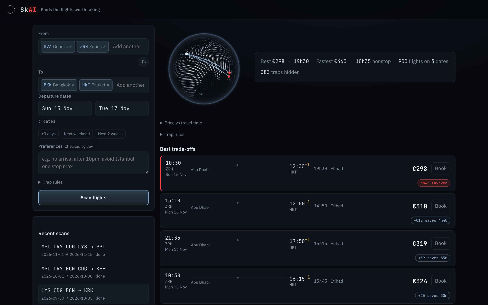
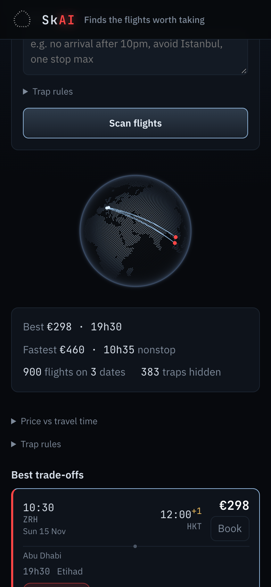
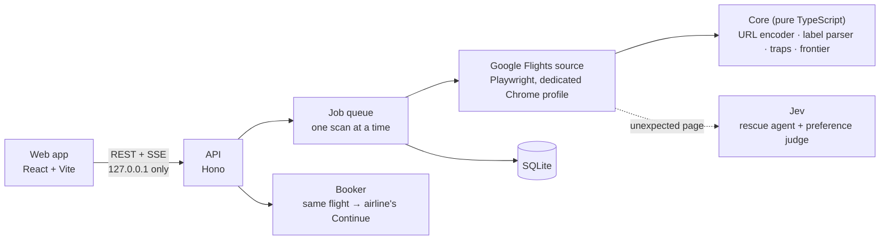

# SkAI

**Finds the flights worth taking.** Scan several departure and arrival airports over a whole range
of dates, drop the itineraries that ruin a trip, and land on the airline's own booking page in one click.



The cheapest fare on a flight search engine is often a trap: a 31-hour trip, an 18-hour layover in Rome,
a change from Heathrow to Gatwick, a reseller instead of the airline. SkAI reads every result, says what
is wrong with it, and keeps only the trade-offs that make sense.

## What it does

- **One scan, every combination.** Up to 7 departure and 7 arrival airports, up to 31 dates, one-way.
  A real scan from Montpellier, Paris (Orly, CDG) and Barcelona to Reykjavík read 7,933 flights on 29 dates.
- **Traps, explained.** Each flight is checked against rules you can tune:

  | Trap | Rule | Effect |
  |---|---|---|
  | Trip too long | More than 2× the fastest flight from the same airport, same day | Red badge |
  | Long layover | A layover over 6 h | Red badge |
  | Tight connection | A layover under 45 min | Badge |
  | Airport change, separate tickets | Stated by the airline listing | Hidden by default |
  | No cabin bag | Stated by the airline listing | Badge |

- **The best trade-offs, priced.** SkAI keeps the flights no other flight beats on both price and travel
  time, and says what each step costs: *+€63 saves 9h25*. From 900 flights to the 5 worth considering.
- **Book with the airline, in one click.** Clicking a flight selects that exact flight and continues to
  the airline's own site with it pre-selected (verified live with Etihad and Icelandair). SkAI never fills
  anything in and never pays.
- **Preferences in plain words** ("no arrival after 10pm, avoid Istanbul"), judged on the best flights by
  [Jev](https://typesafe.ai), TypeSafe's typed-judgment model. Optional: everything else works without it.
- **Nothing is lost.** If the scan is blocked or cancelled, the dates already read are kept.

<p align="center"></p>

## How it works



A few design choices worth a look:

- **No form filling.** Google Flights encodes a search in a protobuf URL parameter (`tfs`).
  [`packages/core/src/tfs.ts`](packages/core/src/tfs.ts) reproduces Google's own URL byte for byte,
  including several airports per side, so each date is one page load.
- **Parsing tested on real data.** Every result exposes an accessible label; the parser is tested on
  562 labels captured live ([`packages/core/fixtures`](packages/core/fixtures)) and refuses anything it
  cannot read fully, so a format change shows up as a coverage warning instead of wrong prices.
- **AI where rules fall short, never for the arithmetic.** Sorting, traps and the frontier are plain,
  deterministic code. Jev (typed choices with probabilities) only rescues unexpected pages and judges
  free-text preferences. The rescue agent is never offered anything that books, pays, signs in or
  accepts tracking, and it clicks only if the page has not changed since it decided.
- **A local server that drives a browser is guarded.** Host and Origin allowlists stop DNS rebinding and
  cross-site calls; every mutating request needs a custom header no other site can send without CORS.
- **Ready to swap the data source.** Scans go through a `FlightSource` interface, so an official API
  (e.g. Duffel) can replace Google without touching the web app.

## What real Google pages taught us

Every one of these was found by running SkAI against live pages, then fixed test-first:

| Found live | Fix |
|---|---|
| Airport changes are worded "layover in London. Transfer here from Heathrow Airport to London Gatwick Airport", so 10 trap flights were unreadable | Parser reads the transfer sentence and flags the airport change |
| On a fresh Chrome profile, the cookie screen's redirect chain aborts a navigation (`net::ERR_ABORTED`) | Wait for the page to leave the consent screen instead of waiting for one navigation |
| Results fill in progressively: the same search returned 80 flights, then 9 | Read only once the list has stopped growing |
| A labelled result row sits under its visible content, which intercepts clicks | Fire the click on the row itself |
| Airlines selling directly appear as "Etihad airline" or as "Icelandair, Economy Light" | Recognise the seller by the flight's airline names |
| A dev proxy keeps a dead progress stream open after a server restart | The client treats 30 s of silence (no event, no ping) as a broken stream and resyncs |

## Stack

TypeScript everywhere · Node 22 · Hono · Playwright · better-sqlite3 · zod · React 19 + Vite ·
[cobe](https://github.com/shuding/cobe) (globe) · [thinking-orbs](https://libraries.dev/orbs) ·
TypeSafe SDK (Jev) · Vitest (169 tests).

```
packages/core   pure TypeScript: schemas, tfs encoder, label parser, traps, frontier
apps/server     API, job queue, SQLite store, Google Flights source, booker, Jev rescue and judge
apps/web        mobile-first React client
docs            design spec, implementation plan, screenshots
```

## Run it

Requires Node 22.12+ and Google Chrome.

```bash
cp .env.example .env   # optional: set TYPESAFE_API_KEY to enable Jev
npm install
npm run dev            # API on 127.0.0.1:4317, web app on http://127.0.0.1:5173
```

SkAI opens its own Chrome window (profile in `~/.skai/chrome-profile`, data in `~/.skai`).

```bash
npm test
npm run typecheck
```

## Responsible use

SkAI is a personal and educational project. Automated access to Google Flights is not permitted by
Google's terms of service; SkAI runs locally at personal volume (one search at a time, with pauses),
stops as soon as Google shows a block page, never retries it and never bypasses a CAPTCHA. It never
books or pays for anything. Not affiliated with or endorsed by Google; "Google Flights" is a trademark
of Google LLC. Use it at your own risk.

## Known limits

- One-way searches, 1 adult, economy, prices in euros.
- Separate tickets (self-transfer) and overnight layovers are not detected until a real Google label
  showing them is captured, so "Hide separate tickets" has no effect yet.
- When two airports of a city tie (e.g. Istanbul IST and SAW), the board shows Google's airport name
  instead of a code.
- The airport list only holds large and medium airports with scheduled service.
- Ports: the API uses `SKAI_PORT` (4317) and the web app `SKAI_WEB_PORT` (5173); set both to run a second copy.
- Stop the server before running `npm run capture -w @skai/server`: both use the same Chrome profile,
  which Chrome locks.

## How it was built

Spec first, then a task-by-task implementation plan, both in [`docs/superpowers`](docs/superpowers):
the [design spec](docs/superpowers/specs/2026-09-24-skai-mvp-design.md) and the
[implementation plan](docs/superpowers/plans/2026-09-24-skai-mvp.md). Tasks were executed with AI coding
agents, test-first, and every diff was reviewed before merge.

## License

[MIT](LICENSE)
